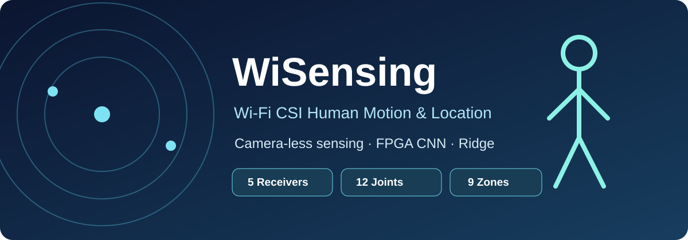
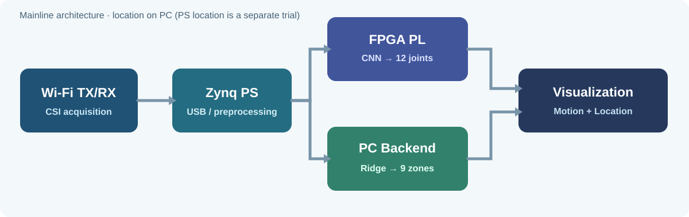

### WiSensing — Wi-Fi CSI 기반 실내 위치·동작 추정 시스템

**TX 1대 · RX 5대 · 9개 위치 구역 · 12관절 자세 추정 · FPGA CNN 가속 · 실시간 2D/3D 시각화**

[주요 기능](#주요-구현-기능) · [시스템 흐름](#전체-시스템-동작-흐름) · [화면 구성](#실시간-시각화-화면) · [저장소 구조](#저장소-구조) · [상세 문서](#상세-문서)

## 주요 구현 기능

WiSensing은 여러 ESP32가 관측한 **Wi-Fi 채널 상태 정보(CSI)**를 이용해 사람의 **실내 위치 구역**과 **12개 신체 관절의 움직임**을 추정하는 시스템입니다. 자세 모델을 학습할 때는 영상에서 추출한 관절 좌표를 정답으로 사용하지만, **실시간 추론에는 카메라 영상을 입력하지 않습니다.**

| 기능 | 구현 내용 | 화면/출력 |
|---|---|---|
| **Wi-Fi CSI 수집** | ESP32 TX가 RX 5대의 CSI 수집 타이밍과 슬롯을 조정하고 수집 주기(cycle)를 취합 | RX 연결·상태·CSI 수신 정보 |
| **실내 위치 추정** | RX별 CSI 진폭·RSSI를 시간 구간으로 묶어 **Portable Ridge**로 분류 | **P01~P09** 위치, **P10**(중앙 위치 앉기), 사람 없음 |
| **12관절 자세 추정** | PS에서 전처리한 CSI를 **FPGA INT8 CNN**으로 추론 | 어깨·팔꿈치·손목·골반·무릎·발목의 좌우 12관절, **24개 (x,y) 값** |
| **2D 관절 시각화** | 추론된 관절을 점·선으로 연결하고 화면 표시를 안정화 | 팔 들기·다리 들기·앉기 등 관절 변화 |
| **3D 캐릭터 표현** | 12관절 방향을 캐릭터 본과 다리 IK에 연결하고 위치 구역의 이동·앉기 상태 표현 | 캐릭터의 위치 이동과 자세 변화 |
| **실시간 통합 UI** | PC Backend가 위치·자세·장치 상태를 취합하여 HTTP/WebSocket으로 전달 | 메인 시연 화면과 별도 관리자/테스트 화면 |
| **시연·검증 도구** | 좌우 동작 전환, 관절 샘플/편집, 녹화 재생, RX 배치 확인, 연결 상태 점검 | 실시간 표시와 독립적인 테스트/진단 |

> **위치 추정은 연속 좌표 회귀가 아닌 구역 분류**입니다. P10은 별도의 열 번째 공간이 아니라 P05와 같은 중앙 지점의 앉기 상태입니다. 3D 캐릭터도 2D 관절을 바탕으로 동작을 표현하는 시각화로, 관측되지 않은 신체 깊이를 직접 복원하는 것은 아닙니다.

## 전체 시스템 동작 흐름

1. **Wi-Fi 신호 수집:** TX 1대가 RX 5대를 관리하고 각 RX가 수신한 CSI를 수집 주기별로 취합합니다.
2. **PS 수신·전처리:** Zynq PS(PetaLinux)가 TX의 **USB CDC ACM** 데이터를 해석하고 CNN 입력을 구성합니다.
3. **Motion 경로:** PS → DDR/AXI → **FPGA PL의 INT8 CNN** → 12관절 추론 결과 → PS로 전달합니다.
4. **Location 경로:** PS의 C Ridge 엔진이 같은 CSI 주기의 진폭·RSSI를 2초 윈도우로 분석하여 9구역·앉기·사람 없음을 분류합니다.
5. **결과 통합·표시:** PC Backend가 최신 위치·관절 정보를 통합하고, Frontend가 **2D 스켈레톤과 3D 캐릭터**를 보여줍니다.

| 데이터 연결 | 방식 | 역할 |
|---|---|---|
| RX → TX | Wi-Fi / UDP 3333 | 수집된 CSI 전달 |
| TX → PS | USB CDC ACM | 수집 주기·상태·명령 응답 |
| PS ↔ PL | DDR + AXI4-Lite | CNN 입력/가중치 로드·추론 제어 |
| PS → PC | TCP 5000 (단일 포트) | PS Location·FPGA Pose·STATUS·ACK 결과 |
| PC Backend → Frontend | HTTP / WebSocket (기본 8000) | 위치·관절·연결 상태 실시간 표시 |

위 흐름은 **기본 실행 구성(`ps/` + `pc/backend/`)**입니다. PS에서 위치를 계산하는 C Ridge 구성을 기본으로 사용하며, `ps_location/`은 해당 기능의 기존 실험 버전을 보관합니다. `integration/`에는 별도의 FPGA Ridge IP 통합 설계 자료가 있습니다.

## 실시간 시각화 화면

| 화면 | 확인할 수 있는 기능 |
|---|---|
| **메인 시연 화면** | 실내 공간의 3D 캐릭터, 2D 관절 스켈레톤, P01~P09 구역 표시, 자세·연결 상태 |
| **위치/모션 보기** | **3번 키**로 위치를 따라 이동하는 보기와 중앙 P05에 고정한 모션 보기를 전환 |
| **좌우 관절 대응** | **좌우 반전 ON/OFF** 버튼으로 2D 스켈레톤과 3D 캐릭터 동작을 함께 전환 |
| **관리자·테스트 화면** | RX 연결/배치, CSI·Pose 수신, 추론 상태, 관절 샘플·편집 및 기록 재생 |
| **기록 재생** | 저장한 추론 결과를 다시 재생하여 관절·위치 표시를 확인 |

실제 UI는 [`pc/frontend/`](pc/frontend/README.md)에서, PC 데이터 통합 및 API는 [`pc/backend/`](pc/backend/README.md)에서 설명합니다. 보드·모델이 없는 환경에서는 Backend의 테스트 입력으로 **화면 흐름만** 확인할 수 있습니다.

## 하드웨어 및 소프트웨어 구성

| 구성 | 하드웨어·도구 | 담당 기능 |
|---|---|---|
| Wi-Fi 센싱 | ESP32-S3 기반 TX, ESP32 계열 RX 5대, ESP-IDF | 신호 송수신·CSI 수집/정렬 |
| 임베디드 처리 | **Zybo Z7-20** (Zynq-7000 PS), PetaLinux, C | USB 수신·전처리·C Ridge 위치 추론·FPGA 제어·TCP 서버 |
| FPGA 가속 | Zynq PL, Verilog, Vivado | INT8 CNN Encoder·FC·가중치 Loader·AXI 인터페이스 |
| AI 모델 | Python, PyTorch, NumPy | 자세 모델 학습·양자화·기준 벡터 및 위치 모델 학습 |
| PC 프로그램 | Python/FastAPI, Three.js, Vite | PS Location·Pose 결과 통합·웹 기반 2D/3D 시각화 |

## 저장소 구조

| 폴더 | 구현한 내용 | 상세 안내 |
|---|---|---|
| [`esp32/`](esp32/README.md) | **TX/RX 펌웨어:** 연결·트리거·슬롯 제어·CSI 수집·USB 전달 | [TX](esp32/ESP-TX/README.md) · [RX](esp32/ESP-RX/README.md) |
| [`ps/`](ps/README.md) | **Zynq PS:** USB CSI 파서, INT8 입력 생성, C Ridge 위치 추론, PL Pose 제어, TCP 전송 | [PS 설명](ps/README.md) |
| [`pl/`](pl/README.md) | **FPGA RTL:** CNN Encoder·FC·Loader·AXI 및 Ridge 관련 RTL/테스트 | [CNN RTL](pl/cnn/README.md) |
| [`ml/`](ml/README.md) | **학습·양자화:** 자세 모델, 위치 모델, INT8 reference·golden 생성 | [Pose](ml/pose/README.md) · [Location](ml/localization/README.md) |
| [`pc/`](pc/README.md) | **PC 앱:** 위치/관절 Backend와 2D·3D 웹 Frontend | [Backend](pc/backend/README.md) · [Frontend](pc/frontend/README.md) |
| [`integration/`](integration/README.md) | Vivado용 CNN/Ridge IP 패키지 및 XSA 통합 산출물 | [하드웨어 통합](integration/README.md) |
| [`ps_location/`](ps_location/README.md) | PS 위치 추론 기능의 이전 개발/검증 버전 보관 | [이전 PS 위치 버전](ps_location/README.md) |
| [`ps_onlysw/`](ps_onlysw/README.md) | FPGA와 비교하기 위한 **PS 소프트웨어 CNN** | [PS 전용 CNN](ps_onlysw/README.md) |
| [`docs/`](docs/README.md) | 시스템 그림, 인터페이스, 실행·운영, 발표 근거, 검증 문서 | [문서 안내](docs/README.md) |

파일 단위의 위치와 원본 RTL ↔ Vivado IP 복사본 관계는 [저장소 파일 안내](docs/repository_structure.md)에 정리되어 있습니다.

## 현재 모델·인터페이스 기준

| 구분 | 기본 RX5 규격 |
|---|---|
| CSI 입력 | RX 5대 × **base / delta / mask** |
| CNN 입력 | INT8 `[15, 128, 10]` = **19,200 bytes** |
| Encoder | RX별 공유 Conv `3→16 (5×3)` → `16→32 (3×3)` → Pool `8×4` |
| FC | Flatten **5120** → **128** → **128** → **24** |
| Motion 출력 | INT8 24개, 12관절 `(x,y)`; `output_scale`로 실수 좌표 복원 |
| Location 출력 | **9개 위치 + 사람 없음 + P10 앉기 = 11클래스** |
| 위치 특징 | 2초 CSI/RSSI 윈도우에서 955개 특징, Portable Ridge |

세부 CNN 연산·정수 반올림은 [CNN RTL](pl/cnn/README.md)과 [INT8 규격](ml/pose/INT8.md), 위치 학습·평가는 [Location](ml/localization/README.md)에서 설명합니다.

## 상세 문서

- **장치·모델별 설명:** [ESP32](esp32/README.md) · [FPGA](pl/README.md) · [PS](ps/README.md) · [ML](ml/README.md) · [PC](pc/README.md)
- **전체 연결·규격:** [시스템 구조](docs/architecture.md) · [인터페이스](docs/interface.md) · [PS↔PC 패킷](docs/ps_pc_protocol.md)
- **설치·실행·검증:** [통합 실행 순서](docs/bringup.md) · [Windows 원클릭 실행](docs/oneclick_launcher.md) · [검증 기록](docs/reviews/2026-10-07-pc-integration.md)

