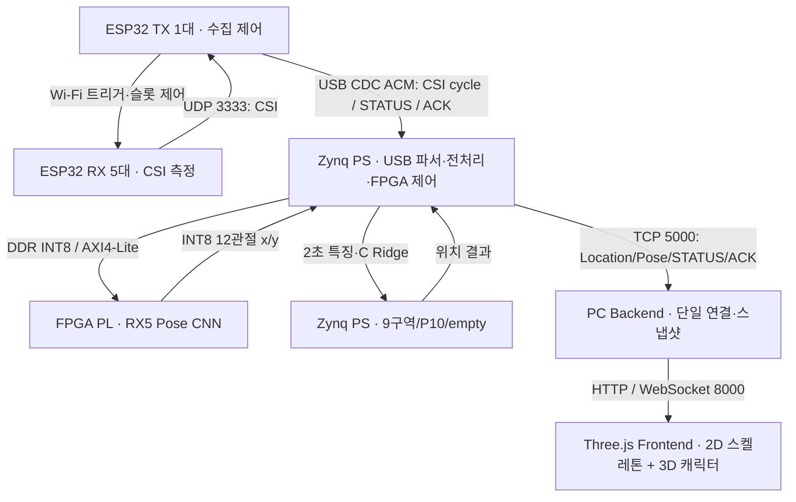

# 전체 시스템 동작 구조

WiSensing은 **ESP32로 CSI를 수집**, **Zynq PS에서 파싱·전처리**, **FPGA CNN으로 12관절 자세 추정**, **PS C Ridge에서 위치를 분류**하고 두 결과를 **실시간 2D/3D 화면으로 표시**합니다. 이 문서는 저장소의 기본 실행 경로(`ps/` + `pc/backend/`)를 설명합니다.

## 데이터가 이동하는 경로

ESP-NOW 제어와 UDP CSI 수집, USB 바이너리 프레임은 서로 다른 연결입니다. `/dev/ttyACM0`은 PS Linux에서 보이는 **USB CDC ACM** 장치명입니다. 보드 측 PS 프로그램의 실행·설치와 포트는 [PS README](../ps/README.md)를 참조하세요.

## Motion: 12개 관절 추정

1. RX 5대에서 모은 CSI를 PS가 검사하고 시간축 10개로 구성합니다.
2. CSI의 base/delta/mask를 각 RX별로 구성하여 INT8 `[15,128,10]`(19,200 bytes)로 만듭니다.
3. PL CNN이 RX별 Encoder → Flatten(5120) → FC(128/128/24)를 연산합니다.
4. PS가 24개 INT8 좌표와 `output_scale`을 전달하고, Frontend가 12관절 스켈레톤과 3D 캐릭터를 표시합니다.

[Pose 학습·양자화](../ml/pose/README.md) · [CNN RTL](../pl/cnn/README.md) · [PS](../ps/README.md) · [Frontend](../pc/frontend/README.md)

## Location: 9개 위치 및 상태 분류

1. PS가 같은 CSI 주기의 유효한 CSI·RSSI를 2초 윈도우로 묶습니다.
2. PS C 위치 엔진이 **955개 특징**을 구성하고 Ridge 계수로 분류합니다.
3. PS는 **P01~P09, P10(중앙 앉기), 사람 없음**의 11개 클래스 결과를 TCP 5000으로 전송합니다.
4. Frontend는 추정 구역을 표시하고, 같은 P05 위치에 해당하는 P10의 앉기 상태를 캐릭터 동작에 활용합니다.

위치는 **학습한 구역별 클래스**를 분류하는 것이고, 모든 위치에서 연속적인 좌표를 복원하는 것은 아닙니다. [Location 모델](../ml/localization/README.md) · [PC Backend](../pc/backend/README.md)

## 결과 통합과 실시간 화면

Backend는 PS에서 전송한 위치·Pose를 **같은 TCP 연결의 서로 다른 메시지(type 5/type 2)**로 받은 후 최신 결과를 Snapshot으로 내보냅니다. 따라서 동일한 화면에 표시되더라도 **동일 시각의 두 추론 결과임을 보장하지 않습니다.** 연결 상태·오래된 추론·누락 데이터는 유효성에 따라 구분하며, 데이터가 없다고 무조건 사람 없음으로 판단하지 않습니다.

Frontend는 2D 관절점, 3D 캐릭터, 9구역 위치 표시, 관리자 상태 확인을 제공합니다. 화면에서 보이는 좌우 반전·관절 안정화·IK는 **시각화 계층**이며 원본 FPGA 추론 결과를 변경하지 않습니다.

## 별도 구성과 하드웨어 확장

| 구성 | 위치 추론 위치 | Pose 추론 위치 | 관련 문서 |
|---|---|---|---|
| **기본 실행 경로** | Zynq PS C Ridge | FPGA PL CNN | [Backend](../pc/backend/README.md), [PS](../ps/README.md) |
| **PS 위치 이전 버전** | Zynq PS C Ridge (개발 기록) | FPGA PL CNN | [ps_location](../ps_location/README.md) |
| **CNN + Ridge IP 통합 자료** | FPGA Ridge IP 설계·XSA | FPGA CNN IP | [integration](../integration/README.md), [PL Ridge](../pl/localization/README.md) |
| **PS 소프트웨어 CNN 비교판** | 종전 PC 위치 모델 | ARM C 소프트웨어 CNN | [ps_onlysw](../ps_onlysw/README.md) |

IP 패키지·XSA가 있어도 실제 장치에 로드·실행·정확도 검증되었는지는 각각의 문서를 기준으로 확인해야 합니다.

## 연결 규격·실행 문서

[구간별 인터페이스](interface.md) · [PS↔PC TCP wire format](ps_pc_protocol.md) · [통합 실행](bringup.md) · [저장소 구조](repository_structure.md)
