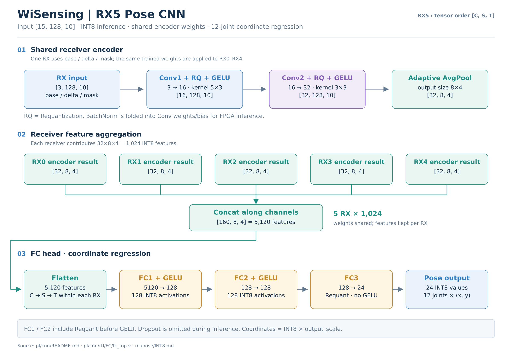
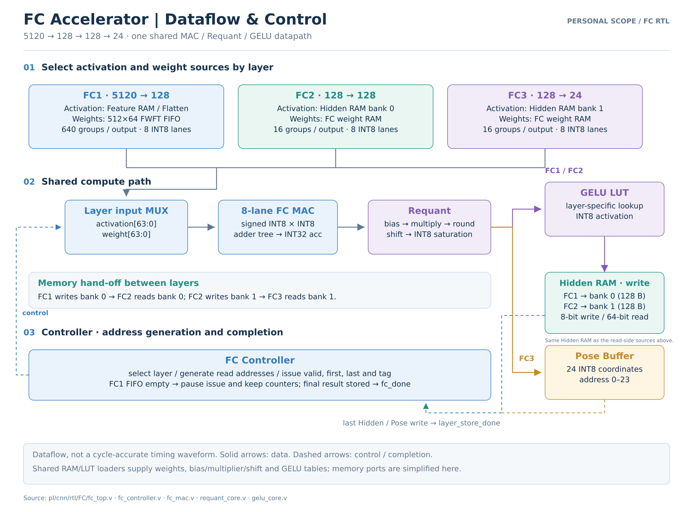

# RX5 CNN · FC 데이터 흐름도

현재 RX5 기본 구성의 모델 흐름과 FC RTL의 데이터·제어 연결을 설명합니다. 정확한 클럭 지연을 나타내는 타이밍 파형은 아닙니다.

## 전체 CNN 구조

- 입력은 base/delta/mask × RX 5대의 INT8 `[15,128,10]`입니다.
- RX별 공유 Encoder 출력은 `[32,8,4]`이며, 5대의 특징을 모으면 `[160,8,4]` = 5,120개입니다.
- FC는 `5120→128→128→24`입니다. FC1/2는 Requant 후 GELU를 적용하며 FC3는 Requant 결과를 바로 저장합니다.
- 학습의 BatchNorm은 Conv 가중치/bias에 folding하고 추론 시 Dropout은 적용하지 않습니다. Concat/Flatten은 모델상의 특징 배열 관계를 나타내며 별도 산술 연산 블록을 의미하지 않습니다.

## FC 담당 구현

| 레이어 | Activation 입력 | 가중치 입력 | 결과 저장 |
|---|---|---|---|
| FC1 | Feature RAM / Flatten, 5,120개 | 기본 512×64 FWFT FIFO | Requant → GELU → Hidden bank 0 |
| FC2 | Hidden bank 0, 128개 | FC weight RAM | Requant → GELU → Hidden bank 1 |
| FC3 | Hidden bank 1, 128개 | FC weight RAM | Requant → Pose Buffer 24개 |

세 레이어는 8-lane signed INT8 MAC과 Requant 경로를 재사용합니다. Hidden RAM의 read/write 표시는 같은 두 bank에 대한 서로 다른 접근을 뜻합니다. Requant는 bias, multiplier, 부호를 고려한 반올림, shift, `[-127,127]` 포화를 수행합니다.

Controller는 레이어·주소·valid/first/last/tag를 관리합니다. FC1 가중치 FIFO가 비면 연산 발행과 카운터 진행을 멈추고, 마지막 Hidden/Pose 결과의 저장을 확인한 뒤 `fc_done`을 발생시킵니다. 실제 공유 파라미터 RAM과 GELU LUT의 로더/읽기 포트 배선은 가독성을 위해 생략했습니다.

## 원본과 수정

- [전체 CNN SVG](assets/cnn/WiSensing_RX5_CNN_Flow.svg) · [FC 상세 SVG](assets/cnn/WiSensing_FC_Dataflow.svg)
- [그림 생성 스크립트](assets/cnn/draw_flows.py): Python 3 + Pillow + Inkscape로 실행하면 스크립트 폴더에 SVG와 2400px PNG를 생성합니다. SVG의 레이블·좌표를 직접 편집할 수도 있습니다.

기존 RX3 참고 그림의 입력 9채널·Flatten 3072를 RX5 입력 15채널·Flatten 5120으로 갱신했습니다. 기존 FC 타이밍 자료는 이 문서에 포함하지 않았습니다.

구현 근거: [CNN 규격](../pl/cnn/README.md) · [fc_top.v](../pl/cnn/rtl/FC/fc_top.v) · [fc_controller.v](../pl/cnn/rtl/FC/fc_controller.v) · [INT8 연산 계약](../ml/pose/INT8.md)
